# Credit Card Fraud Detection

An end-to-end machine-learning project that detects fraudulent credit card transactions in a heavily imbalanced dataset (about 0.17 % fraud). It emphasises leakage-free, time-ordered validation and business-driven metrics over accuracy, and ships the result as an explainable Streamlit app.


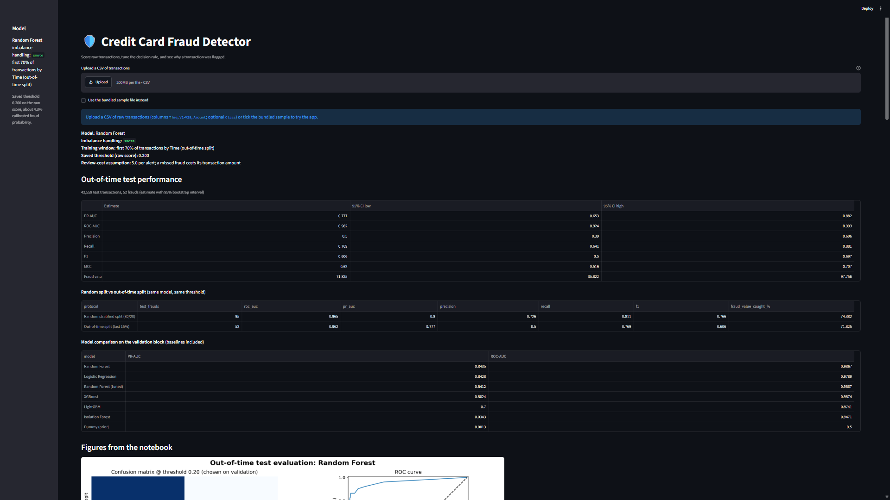

## Highlights

- **Out-of-time validation.** Transactions are sorted by time and split 70 % / 15 % / 15 % into train / validation / test, so the model is always evaluated on data from its *future*. A random split is reported once, as a comparison, to show how optimistic it can be.
- **Imbalance handling is tested, not assumed.** No resampling vs class weights vs SMOTE vs undersampling, compared on time-ordered folds, with exactly one fix per pipeline (combining SMOTE with class weights counts the imbalance twice).
- **A decision threshold driven by business cost.** The threshold minimises an expected cost built from real transaction amounts (a missed fraud costs its amount, every alert costs a review fee) instead of maximising F1.
- **Honest evaluation.** PR-AUC as the headline metric, plus ROC-AUC, MCC, the share of fraud *value* caught, recall at a fixed alert budget and bootstrap 95 % confidence intervals.
- **Calibration and error analysis.** Platt scaling turns scores into probabilities, and missed frauds and false alarms are inspected one by one.
- **Explainability.** SHAP (global summaries and per-transaction waterfalls), cross-checked with permutation importance.
- **Shipped as an app.** A Streamlit app runs on a single model bundle (pipeline + threshold + calibrator + features) and lets you score transactions, change the decision rule and see why a transaction was flagged.

## Results

The numbers below are written by the notebook's final export cell, so they always match the model in `model/`. They refer to the out-of-time test block unless stated otherwise. The test block contains only a few dozen frauds, so read the confidence intervals, not just the point estimates.

<!-- RESULTS:START -->
**Final model:** Random Forest · imbalance handling: `smote` · trained on the first 70 % of transactions by time  
**Decision threshold:** 0.200 on the raw model score, chosen on the validation block by minimising expected cost (review cost assumed to be 5 per alert; a missed fraud costs its transaction amount)

### Out-of-time test block: 42,559 transactions, 52 frauds

| Metric | Estimate | 95% CI low | 95% CI high |
|---|---|---|---|
| PR-AUC | 0.777 | 0.653 | 0.882 |
| ROC-AUC | 0.962 | 0.924 | 0.993 |
| Precision | 0.500 | 0.390 | 0.606 |
| Recall | 0.769 | 0.641 | 0.881 |
| F1 | 0.606 | 0.500 | 0.697 |
| MCC | 0.620 | 0.516 | 0.707 |
| Fraud value caught (%) | 71.825 | 35.822 | 97.756 |

At the chosen threshold: 40 of 52 frauds caught, 12 missed, 40 false alarms.

### Random split vs out-of-time split (same model, same threshold)

| Protocol | Test frauds | ROC-AUC | PR-AUC | Precision | Recall | F1 | Fraud value caught (%) |
|---|---|---|---|---|---|---|---|
| Random stratified split (80/20) | 95 | 0.965 | 0.800 | 0.726 | 0.811 | 0.766 | 74.382 |
| Out-of-time split (last 15%) | 52 | 0.962 | 0.777 | 0.500 | 0.769 | 0.606 | 71.825 |

### Model comparison on the validation block (baselines included)

| Model | PR-AUC | ROC-AUC |
|---|---|---|
| Random Forest | 0.844 | 0.987 |
| Logistic Regression | 0.843 | 0.979 |
| Random Forest (tuned) | 0.841 | 0.987 |
| XGBoost | 0.802 | 0.987 |
| LightGBM | 0.700 | 0.974 |
| Isolation Forest | 0.034 | 0.947 |
| Dummy (prior) | 0.001 | 0.500 |

### Imbalance-handling ablation (mean PR-AUC, time-ordered CV)

| Strategy | LightGBM | Logistic Regression | Random Forest |
|---|---|---|---|
| none | 0.612 | 0.555 | 0.741 |
| class_weight | 0.416 | 0.663 | 0.735 |
| smote | 0.762 | 0.679 | 0.737 |
| undersample | 0.756 | 0.469 | 0.717 |

<sub>Generated by the notebook on 2026-10-25.</sub>
<!-- RESULTS:END -->

<p align="center">
  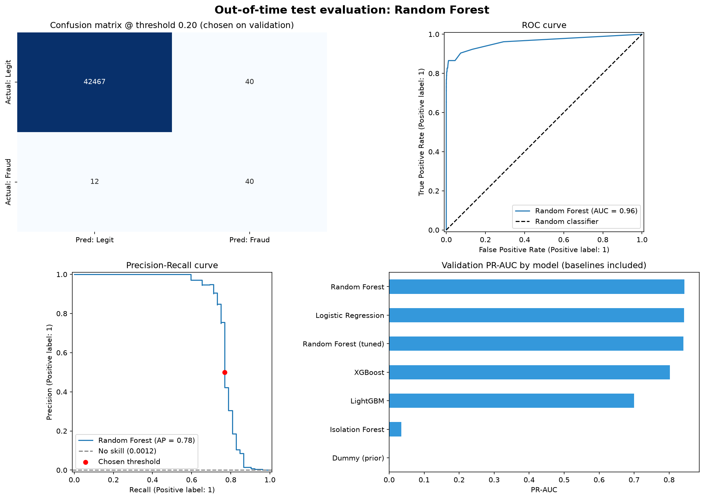
  <br><em>Confusion matrix at the chosen threshold, ROC and precision-recall curves on the out-of-time test block, and validation PR-AUC of every model including the baselines.</em>
</p>

## Dataset

[Credit Card Fraud Detection](https://www.kaggle.com/datasets/mlg-ulb/creditcardfraud) by the ULB Machine Learning Group: 284,807 transactions made by European cardholders over two days, 492 of them fraudulent (0.173 %).

| Column | Meaning |
|---|---|
| `V1`–`V28` | Principal components of the original (confidential) features |
| `Time` | Seconds elapsed since the *first* transaction in the dataset (not a clock time) |
| `Amount` | Transaction amount |
| `Class` | Label: 0 = legitimate, 1 = fraud |

1,081 exact duplicate rows are removed before any splitting.

## What the project does

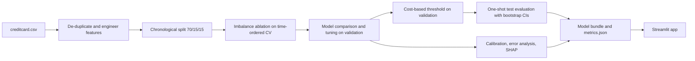

### 1. Exploratory data analysis

Findings that shaped the modelling: fraud is a tiny fraction of transactions, amounts are heavy-tailed (so plots use log(1 + Amount)), transaction volume follows a day/night cycle, and the V-features are PCA components that are uncorrelated with each other (so a sorted bar chart of correlation with `Class` replaces a mostly empty 30×30 heatmap).

<p align="center">
  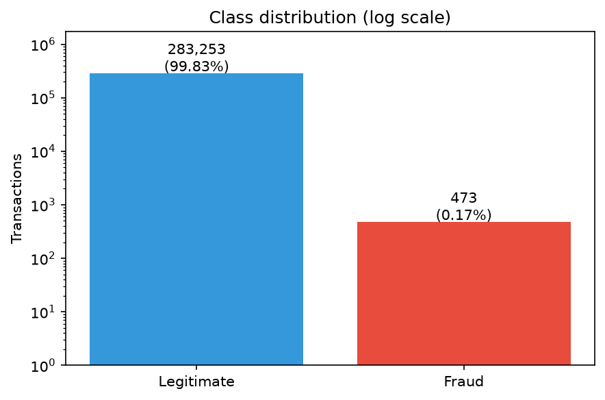
  <br><em>Class distribution on a log scale: accuracy is meaningless at this imbalance.</em>
</p>
<p align="center">
  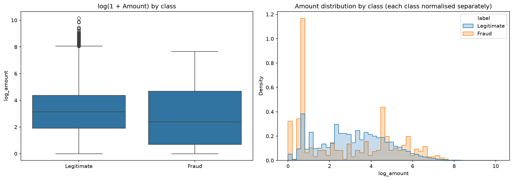
  <br><em>Amount by class on a log(1 + Amount) scale.</em>
</p>
<p align="center">
  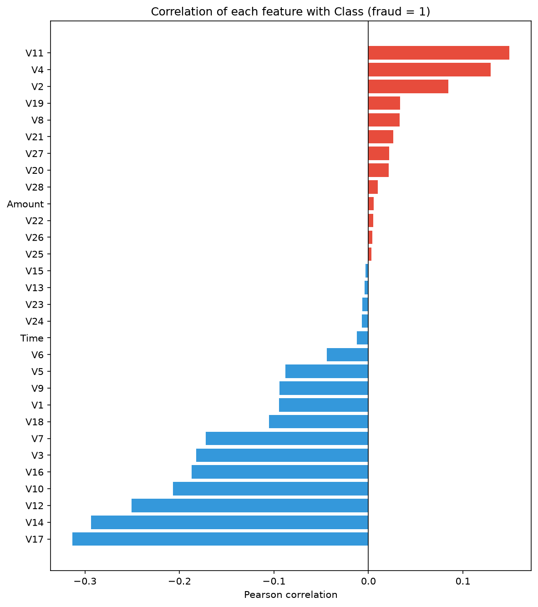
  <br><em>Correlation of every feature with the fraud label.</em>
</p>
<p align="center">
  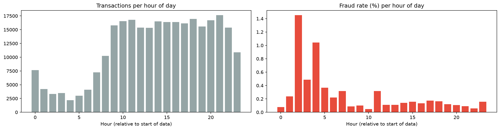
  <br><em>Volume and fraud rate by hour of day (hours are relative to the start of the data). The rate is noisy because each hourly bucket holds few frauds.</em>
</p>

### 2. Features and out-of-time split

- **31 features:** `V1`–`V28`, `log_amount = log(1 + Amount)` and the hour of day as `hour_sin` / `hour_cos`. Raw `Time` is dropped: it only grows, so in a time-ordered split the test period lies outside anything seen in training and tree models cannot extrapolate.
- **Chronological split:** the first 70 % of transactions train every model, the next 15 % (validation) is used for model selection, tuning and the decision threshold, and the last 15 % (test) is used once at the end.

### 3. Handling the class imbalance

Four strategies were compared on the same time-ordered folds (`TimeSeriesSplit`: always train on the past, validate on the next block) for logistic regression, random forest and LightGBM: no resampling, class weights, SMOTE, and random undersampling to 10 legit : 1 fraud. The strategy with the best mean PR-AUC is used for every candidate model. SMOTE and class weights are never combined in one pipeline.

<p align="center">
  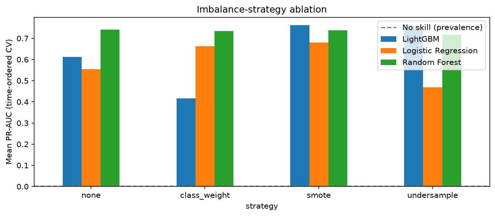
  <br><em>Mean PR-AUC on time-ordered folds per imbalance strategy and model; the dashed line is the no-skill level (fraud prevalence).</em>
</p>

### 4. Model comparison and tuning

Logistic regression, random forest, XGBoost and LightGBM are compared on the validation block against two baselines: a dummy classifier (no skill, PR-AUC equals the fraud prevalence) and an unsupervised Isolation Forest. The best supervised model gets a small `RandomizedSearchCV` (scored on average precision, time-ordered folds), and the final model is the one with the best validation PR-AUC.

<p align="center">
  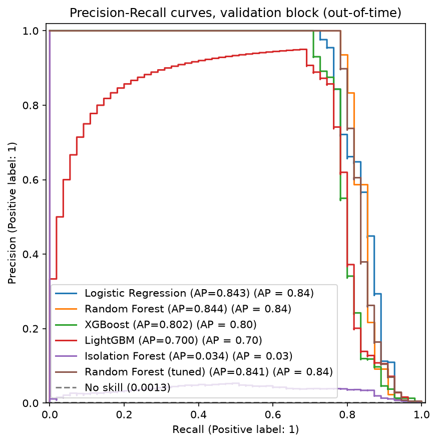
  <br><em>Precision-recall curves of all candidates on the validation block, with the no-skill line.</em>
</p>

### 5. Decision threshold

The default threshold of 0.5 has no special meaning for resampled or re-weighted models, and F1 treats both error types symmetrically although a missed fraud usually costs far more than a false alert. Four rules are compared on the validation block: default 0.5, best F1, best F2, and **minimum expected cost**, where every alert costs a review fee (`REVIEW_COST`, an assumption) and every missed fraud costs its actual `Amount`. A sensitivity table shows how the optimum moves with the review fee. The chosen threshold is frozen before the test block is touched.

<p align="center">
  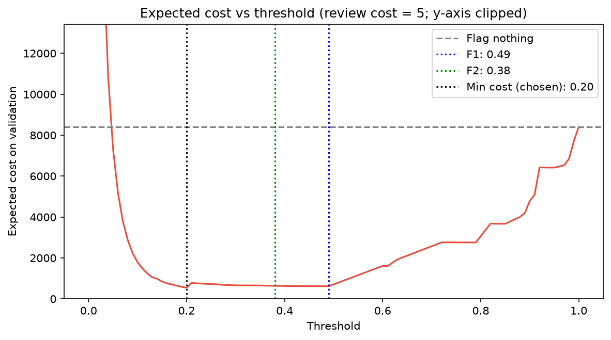
  <br><em>Expected cost on the validation block vs threshold (y-axis clipped: alerting on everything costs far more).</em>
</p>

### 6. Test-set evaluation

The final pipeline and threshold are applied once to the test block. Reported: precision, recall, F1, MCC, PR-AUC and ROC-AUC with 1,000-resample bootstrap 95 % confidence intervals; the share of fraud *value* caught; recall for a fixed alert budget ("review the top 0.1 % riskiest transactions"); and the same model evaluated under a random split next to the out-of-time split.

### 7. Calibration

Models trained on resampled or re-weighted data output scores that are not probabilities. Platt scaling (a one-feature logistic regression on the logit of the score, fitted on the validation block only) maps them to calibrated probabilities. The mapping is monotonic, so PR-AUC and ROC-AUC do not change.

<p align="center">
  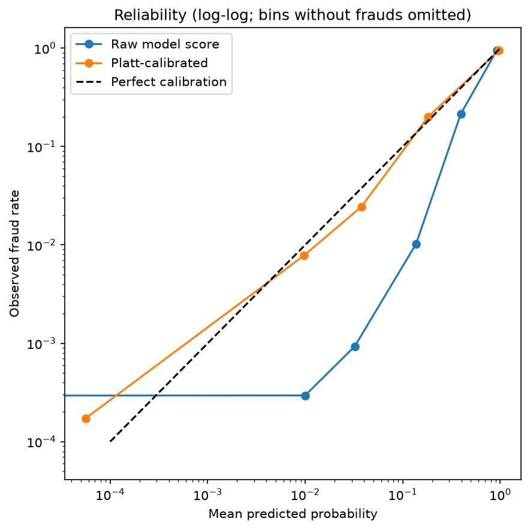
  <br><em>Observed fraud rate vs mean predicted probability, before and after calibration (log-log; bins without frauds are omitted).</em>
</p>

### 8. Error analysis

Missed frauds and false alarms on the test block are listed with their amount, hour and score, and the score distribution of the frauds is plotted against the threshold. This separates misses that are close to the threshold (a cost-setting question) from misses the model cannot see at all (a features / data question).

### 9. Explainability

SHAP is computed on *all* test-block frauds plus 500 random legitimate transactions (a random sample of the test block would contain almost no frauds), once on the mixed sample and once on frauds only. Waterfall plots explain individual caught and missed frauds. Permutation importance on the validation block is used as a second, independent view.

<p align="center">
  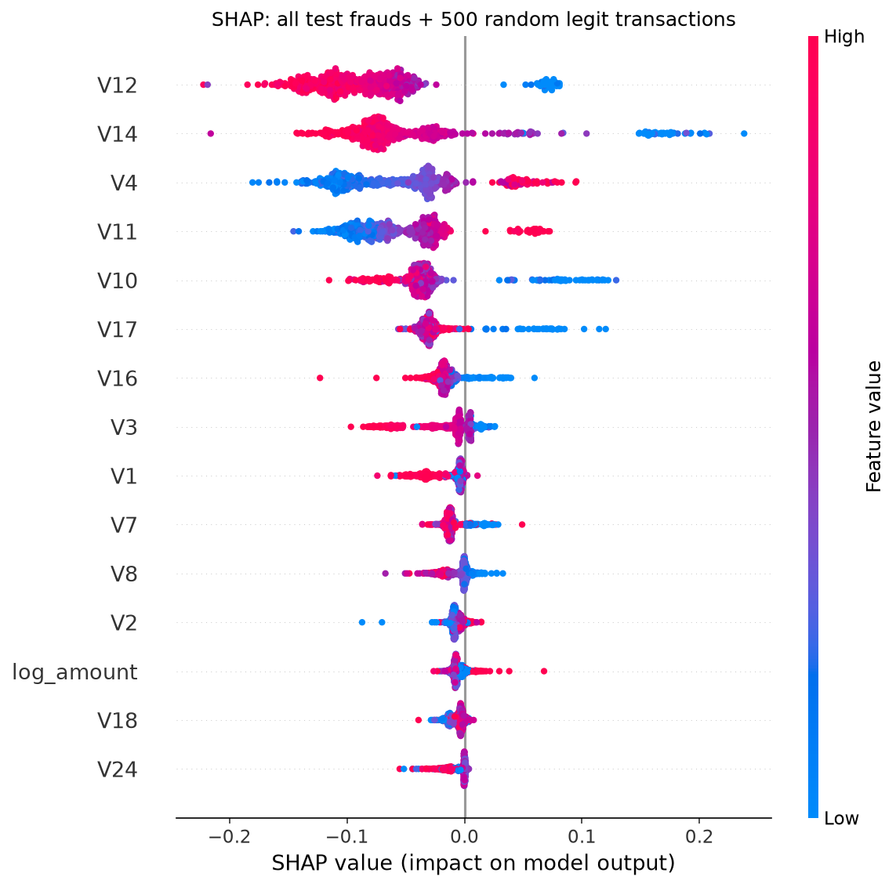
  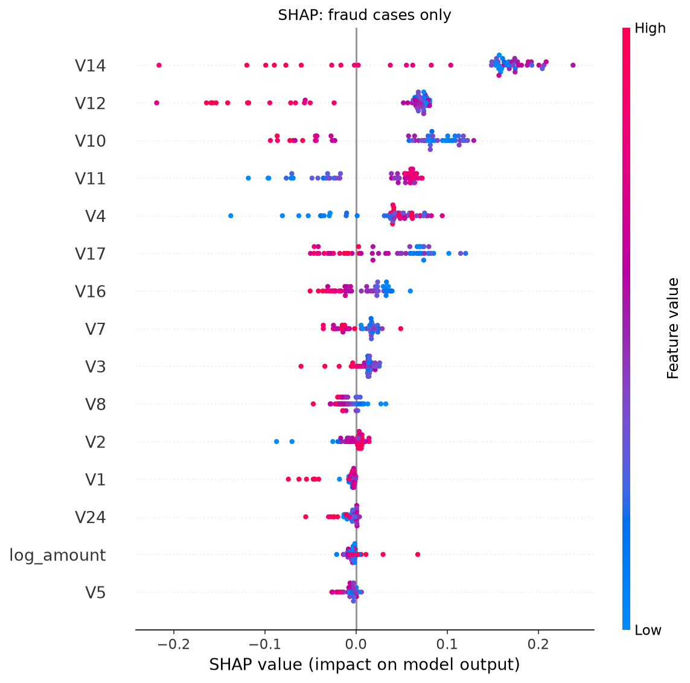
  <br><em>SHAP summaries: all test frauds + 500 legit transactions (left) and frauds only (right). Colour is the feature value, position is the push on the fraud score.</em>
</p>
<p align="center">
  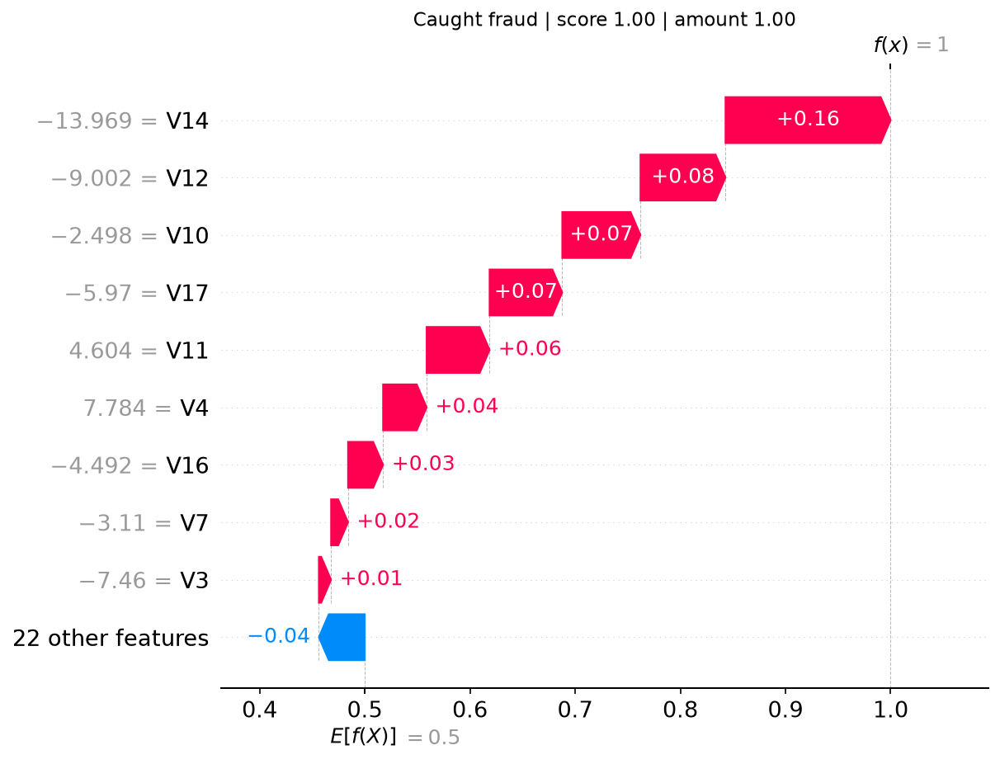
  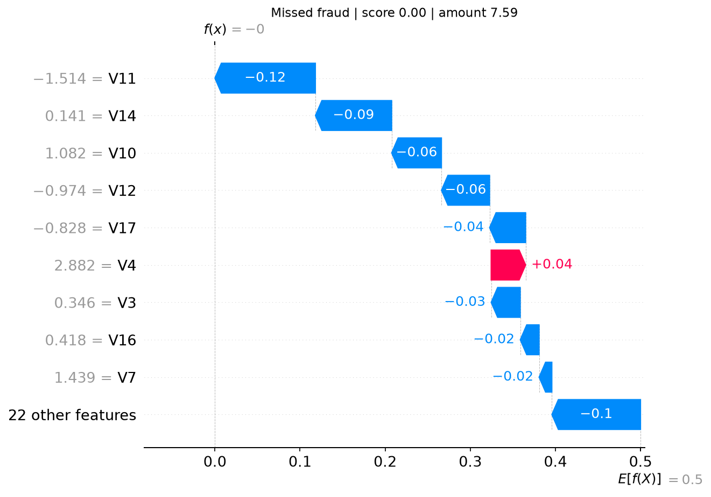
  <br><em>Highest-scoring caught fraud (left) and lowest-scoring missed fraud (right).</em>
</p>

SHAP shows what the **model relies on**, not what causes fraud, and `V1`–`V28` are PCA components with no business meaning of their own.

### 10. Packaging

`model/fraud_model_bundle.joblib` is one dictionary holding the fitted pipeline, the frozen threshold, the Platt calibrator, the ordered feature list and metadata. `model/metrics.json` stores the test metrics, model comparisons and the library versions used for training. The app only needs the bundle; `metrics.json`, `images/` and `sample.csv` enrich its *Model card* tab and the demo.

## The Streamlit app

```bash
streamlit run app/app.py
```

**Input:** a CSV with the raw dataset columns `Time`, `V1`–`V28`, `Amount` and optionally `Class` (0/1). Feature engineering is applied inside the app with the same code as the notebook. Tick *Use the bundled sample file* to try it without uploading anything.

**What it does**

- Validates the file (clear error for missing columns; rows with missing, non-numeric or negative values are excluded with a warning) and scores every transaction: raw model score, calibrated fraud probability and expected loss (probability × amount).
- **Decision rule** (sidebar): the saved cost-optimised threshold, a custom score threshold, or an alert budget ("review the top X % riskiest transactions"). Scoring is cached, so moving a slider never re-scores the file.
- **Results tab:** score histogram with the threshold, sortable and filterable table, and downloads of all scored transactions or only the flagged ones.
- **Evaluation:** if the file has a `Class` column, the KPIs show frauds caught / missed, false alarms, precision, recall, the share of fraud value caught and the expected cost compared with flagging nothing. A *Threshold analysis* tab plots the cost curve for the uploaded data.
- **Explain a transaction:** a SHAP waterfall and a plain-language list of the features pushing the score up and down.
- **Global drivers:** SHAP summary on a sample of the uploaded file.
- **Model card:** test metrics with confidence intervals, model comparison, the notebook figures and the limitations.
- **Safety checks:** a sidebar warning if installed library versions differ from the training environment, and caches keyed on the bundle file, so a retrained model is picked up without restarting.

Tree models (random forest, XGBoost, LightGBM) are explained with `TreeExplainer`; logistic regression uses exact linear SHAP values.

## Repository structure

```
.
├── app/
│   ├── app.py                       # Streamlit app
│   └── sample.csv                   # 20 raw transactions for the demo (written by the notebook)
├── data/                            # put creditcard.csv here (git-ignored)
├── images/                          # figures used in this README and in the app
├── model/
│   ├── fraud_model_bundle.joblib    # pipeline + threshold + calibrator + features
│   └── metrics.json                 # test metrics, comparisons, library versions
├── notebook/
│   └── credit_card_fraud_detection.ipynb
├── requirements.txt                 # pinned to the training environment
└── README.md
```

The notebook also writes working copies (`fraud_model_bundle.joblib`, `sample.csv`, `model_evaluation.png`) into `notebook/`; the export cells copy the ones that matter, so it is safe to git-ignore these.

## Getting started

1. **Clone** the repository and create a virtual environment:

   ```bash
   python -m venv .venv
   source .venv/bin/activate          # Windows: .venv\Scripts\activate
   pip install -r requirements.txt
   pip install jupyter                # only needed to run the notebook
   ```

2. **Get the data:** download `creditcard.csv` from [Kaggle](https://www.kaggle.com/datasets/mlg-ulb/creditcardfraud) into `data/` (or, with Kaggle API credentials: `kaggle datasets download -d mlg-ulb/creditcardfraud -p data --unzip`).

3. **Run the notebook** top to bottom (`jupyter lab notebook/credit_card_fraud_detection.ipynb`). Expect roughly 15 to 40 minutes on a laptop CPU; the random-forest ablation and tuning, SHAP, permutation importance and the bootstrap take the longest. The final export cells write the figures to `images/`, the bundle and `metrics.json` to `model/`, `sample.csv` to `app/`, and fill in the **Results** section of this README.

4. **Start the app:** `streamlit run app/app.py`

Everything is seeded (`random_state=42`). `requirements.txt` pins the versions used for training, because a pickled model only loads reliably with the same scikit-learn / imbalanced-learn / XGBoost / LightGBM versions (the app warns when they differ).

## Model card: assumptions and limitations

- **Intended use:** a methodology demonstration on a public dataset, not a production fraud system.
- **Cost model:** the review fee per alert is an assumption (`REVIEW_COST` in the notebook, adjustable in the app) and fraud loss is approximated by the transaction amount, ignoring chargeback fees, recovered funds and customer churn.
- **Short horizon:** the data covers about two days, so the out-of-time split tests a very short future and says nothing about seasonality or long-term drift.
- **No identifiers:** there is no card, customer or merchant ID, so velocity and history features, usually the biggest real-world gain, are impossible.
- **Few frauds:** the test block holds only a few dozen, so confidence intervals are wide and small differences between models are not meaningful. Model selection and threshold choice share one validation block, which adds slight optimism.
- **Anonymised features:** `V1`–`V28` are PCA components, so explanations describe the model's reliance on components, not business reasons, and importance is not causation.
- **Security:** `.joblib` files are pickles and can execute code when loaded. Only load bundles you created or trust.
- **File size:** the compressed bundle may exceed GitHub's 100 MB limit for large forests; use [Git LFS](https://git-lfs.com) or attach it to a release.

## Roadmap

- Account-level velocity features if card / customer identifiers become available.
- Rolling-origin evaluation (several train/test windows) once more than two days of data exist.
- An amount-aware decision rule on calibrated probabilities: flag when `probability × amount ≥ review cost`.
- Refit on train + validation before deployment, with drift monitoring (for example PSI) and scheduled retraining.
- Cost-sensitive boosting objectives and semi-supervised / autoencoder models as additional ensemble members.

## Data source and acknowledgements

Dataset: ULB Machine Learning Group, [Credit Card Fraud Detection](https://www.kaggle.com/datasets/mlg-ulb/creditcardfraud) (collected and analysed during a research collaboration of Worldline and the ULB Machine Learning Group). Please see the dataset page for its terms of use. Citation:

> Andrea Dal Pozzolo, Olivier Caelen, Reid A. Johnson and Gianluca Bontempi. *Calibrating Probability with Undersampling for Unbalanced Classification.* In Symposium on Computational Intelligence and Data Mining (CIDM), IEEE, 2015.